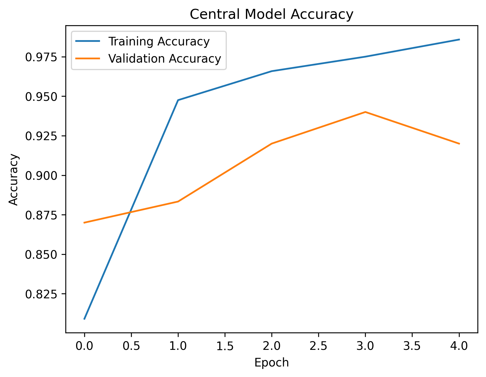
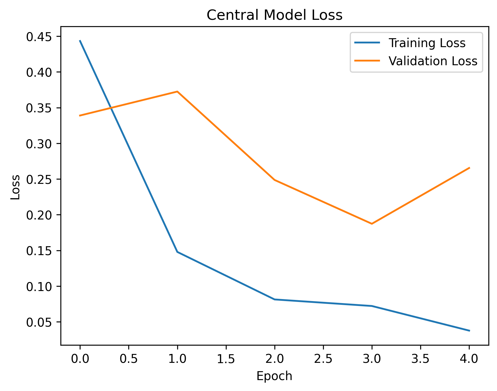
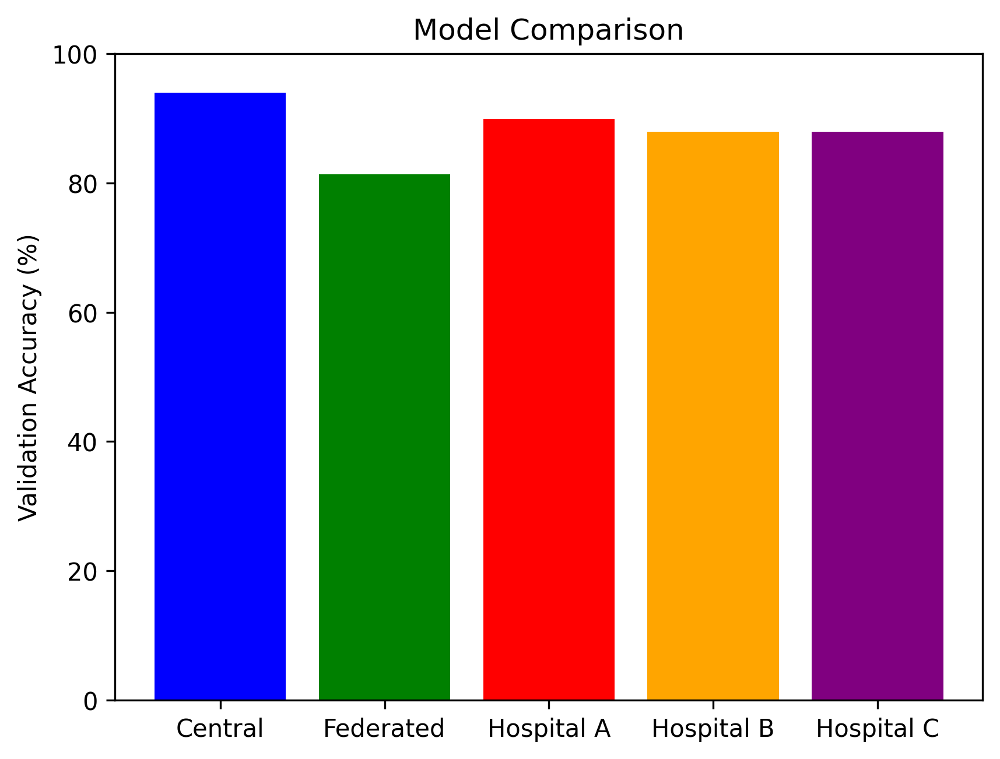

# Federated Learning for Pneumonia Detection Using Chest X-Ray Images

**A privacy-aware deep learning framework for collaborative medical image classification**


## 1. Project Overview

This project explores federated learning for pneumonia detection using chest X-ray images.

Traditional centralized machine learning requires data from different institutions to be collected in one location. In healthcare, this can create privacy, security, and data governance challenges.

Federated learning offers an alternative by allowing participating institutions to train models locally while sharing model parameters rather than raw patient images.

The project implements a simulated multi-hospital federated learning workflow using convolutional neural networks (CNNs) and Federated Averaging (FedAvg).

It also includes a centralized learning baseline to support comparative evaluation.

**Research focus:** Medical image analysis, distributed machine learning, and privacy-aware artificial intelligence.

## 2. Research Objectives

The objectives of this project are to:

1. Develop CNN-based models for pneumonia classification from chest X-ray images.
2. Simulate collaborative training across separate hospital datasets.
3. Implement Federated Averaging to aggregate locally trained models.
4. Develop a centralized baseline for comparison.
5. Evaluate model performance using classification accuracy, loss, and visualizations.
6. Investigate the potential of federated learning for healthcare applications where raw data sharing is restricted.

## 3. Technologies Used

| Technology | Purpose |
|---|---|
| Python 3.10 | Project development |
| TensorFlow/Keras | Deep learning model development |
| Convolutional Neural Networks | Medical image classification |
| Federated Averaging | Model aggregation |
| Chest X-ray images | Pneumonia classification dataset |

Additional dependencies are documented in `requirements.txt`.

## 4. Research Methodology

### 4.1 Dataset Preparation

The project uses chest X-ray images from publicly available sources.

Dataset preparation includes splitting the available images into separate partitions to simulate multiple participating hospitals.

The dataset preparation scripts are located in the `src/` directory.

### 4.2 Local Model Training

Each simulated hospital trains a CNN using its assigned local dataset.

The local training process is intended to represent institutions collaborating without transferring their raw medical images to a central training repository.

### 4.3 Federated Averaging

The project implements Federated Averaging (FedAvg), an aggregation method used in federated machine learning.

The workflow consists of:

1. Initializing the learning process.
2. Training local models on hospital-specific data.
3. Collecting model parameters from participating clients.
4. Aggregating parameters to update the global model.
5. Redistributing the global model for subsequent training rounds.

### 4.4 Centralized Baseline

A centralized CNN training pipeline is included as a baseline.

This allows comparison between the centralized and federated approaches.

### 4.5 Model Evaluation

The repository includes evaluation scripts for:

- Centralized model performance.
- Federated global model performance.
- Individual hospital model performance.
- Accuracy and loss analysis.
- Model comparison visualizations.

## 5. Project Structure

```text
federated_learning_project/
|
|-- src/
|   |-- split_dataset.py
|   |-- create_central_dataset.py
|   |-- train_central_model.py
|   |-- train_hospital_model.py
|   |-- training_hospital_model.py
|   |-- federated_averaging.py
|   |-- evaluate_central_model.py
|   |-- evaluate_federated_model.py
|   |-- evaluate_hospital_model.py
|   |-- check_dataset.py
|
|-- results/
|   |-- central_model_accuracy.png
|   |-- central_model_loss.png
|   |-- model_comparison.png
|
|-- requirements.txt
|-- .gitignore
|-- README.md
```

## 6. Installation

Clone the repository:

```bash
git clone https://github.com/Ogunnubi/federated_learning_project.git
cd federated_learning_project
```

Install the required dependencies:

```bash
pip install -r requirements.txt
```

## 7. Running the Project

### Step 1: Prepare the Dataset

```bash
python src/split_dataset.py
```

### Step 2: Train Hospital Models

```bash
python src/train_hospital_model.py
```

### Step 3: Train the Centralized Baseline

```bash
python src/train_central_model.py
```

### Step 4: Perform Federated Averaging

```bash
python src/federated_averaging.py
```

### Step 5: Evaluate the Models

```bash
python src/evaluate_central_model.py
python src/evaluate_federated_model.py
python src/evaluate_hospital_model.py
```

**Note:** Dataset paths, configuration settings, and any required trained-model files should be checked before running the scripts.

## 8. Experimental Results

The repository includes visualization files for reviewing model performance.

### Centralized Model Accuracy



### Centralized Model Loss



### Model Comparison



These visualizations support evaluation of the training process and comparison of learning approaches.

Quantitative findings should be interpreted using the actual experiment outputs, including the dataset partitioning strategy, evaluation dataset, and training configuration.

## 9. Research Significance

Federated learning is relevant to medical artificial intelligence because healthcare institutions may face restrictions on sharing sensitive patient information.

This project provides an experimental framework for exploring collaborative model development without requiring raw image data to be pooled centrally.

The work is particularly relevant to research in:

- Artificial intelligence for healthcare.
- Medical image classification.
- Distributed and collaborative learning.
- Privacy-aware machine learning.
- Robust machine learning across heterogeneous datasets.

## 10. Limitations

This project is a research prototype using publicly available medical image data and simulated hospital partitions.

Important limitations include:

- Simulated hospital datasets do not necessarily represent real institutional differences.
- Model performance may depend on dataset size, image quality, and partitioning strategy.
- Federated learning alone does not guarantee privacy or regulatory compliance.
- Model parameters can potentially leak sensitive information.
- External clinical validation would be required before considering real-world medical use.

The framework is not intended for clinical diagnosis.

## 11. Future Research Directions

Potential extensions include:

1. Implementing differential privacy.
2. Investigating secure aggregation.
3. Evaluating heterogeneous, non-IID hospital datasets.
4. Comparing CNN architectures such as ResNet and EfficientNet.
5. Conducting cross-institutional validation.
6. Studying communication efficiency and convergence.
7. Exploring explainable AI methods for medical image classification.
8. Investigating deployment considerations for federated healthcare systems.

These directions provide opportunities for further research in medical artificial intelligence and distributed machine learning.

## 12. References and Acknowledgements

McMahan, H. B., et al. (2017). Communication-Efficient Learning of Deep Networks from Decentralized Data. *Proceedings of AISTATS.*

TensorFlow/Keras was used for deep learning development.

Chest X-ray images were obtained from publicly available data sources.

The precise dataset source, licence, and any additional third-party dependencies should be credited before final publication.

## 13. Author

**Oluwaseun Damilola Ogunnubi**

MSc Cloud Computing (Distinction)  
University of Lincoln, United Kingdom

Research interests: Applied Artificial Intelligence, Medical Imaging, Federated Learning, and Healthcare Data Science.

**GitHub:** https://github.com/Ogunnubi
